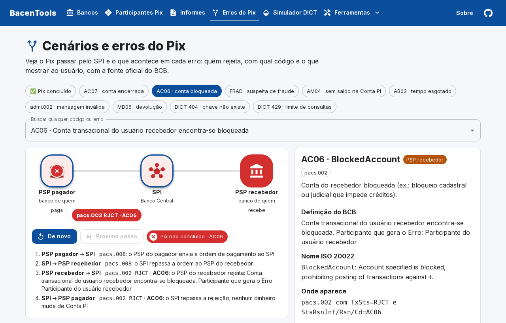

<div align="center">

# 🏛️ BacenTools

**Ferramentas gratuitas do Pix e do Banco Central para POs, QAs e devs**

Consultas rápidas e simuladores do dia a dia de quem trabalha com pagamentos instantâneos: sem cadastro, sem servidor e com fonte oficial.

### 🔗 [bacentools.web.app](https://bacentools.web.app)

[](https://github.com/vieiraes/bacentools/actions/workflows/ci.yml)
[](https://github.com/vieiraes/bacentools/actions/workflows/dados.yml)
[](LICENSE)


</div>

## ✨ Ferramentas

| | Ferramenta | Para que serve | Fonte dos dados |
|---|---|---|---|
| 🏦 | **[Bancos](https://bacentools.web.app/bancos/)** | Descobrir de quem é um ISPB ou um código COMPE, com logo e sede | BrasilAPI (dados do BCB) |
| 💠 | **[Participantes do Pix](https://bacentools.web.app/participantes-pix/)** | As 880 instituições do Pix, com modalidade, participação direta ou indireta e início da operação | BrasilAPI (dados do BCB) |
| 📄 | **[Informes SPI e STR](https://bacentools.web.app/informes/)** | Os informes operacionais publicados pelo Banco Central, por ano, com o PDF | Banco Central |
| 🔀 | **[Cenários e erros do Pix](https://bacentools.web.app/cenarios-pix/)** | Animação do caminho do Pix (pagador → SPI → recebedor) em cada erro: quem rejeita, com qual código e o que mostrar ao usuário. São 75 códigos, cada um com a fonte oficial | Catálogo de Mensagens do SPI 5.13.2 e manuais do Pix |
| 🔳 | **[Decodificador de QR Code Pix](https://bacentools.web.app/decodificador-pix/)** | Cole um Pix Copia e Cola: tipo (estático, dinâmico, composto), chave, valor, txid, URL e CRC, com cada campo conferido e a seção do manual. Mostra o CRC certo quando o informado está errado | Manual de Padrões para Iniciação do Pix 2.10.0 |
| 🆔 | **[Decodificador de EndToEndId e UUID](https://bacentools.web.app/identificadores-pix/)** | Quem gerou um EndToEndId ou RtrId (nome da instituição pelo ISPB), quando (UTC e Brasília) e o que está fora do formato. Também lê UUID, inclusive a data do v7 | Catálogo do SPI 5.13.2 e RFC 9562 |
| 💧 | **[Simulador de fichas do DICT](https://bacentools.web.app/simulador-dict/)** | O *token bucket* das consultas de chave Pix: 200, 404, 429, reposição e devolução por pagamento | Especificação da API do DICT |

<details>
<summary>📸 Mais telas</summary>




</details>

## 🎯 Por que existe

Quem testa ou especifica produtos de Pix vive consultando o ISPB de um banco, procurando o significado de um `AC06` numa planilha do BCB ou tentando entender por que o DICT devolveu `429`. O BacenTools junta essas respostas num lugar só, com uma regra: **tudo o que é afirmado sobre o Pix tem fonte oficial do Banco Central**, com o documento, a versão e a seção. O que é dedução aparece marcado como dedução.

## 🧪 Estratégia de testes

Este projeto também é uma vitrine de QA. A pirâmide de testes é esta:

| Camada | Ferramenta | O que cobre |
|---|---|---|
| **Regra de negócio** | Vitest | A regra do DICT como função pura: **tabela de decisão** (200, 404 e 429 × saldo do usuário × saldo do participante), **valor-limite** (0; 0,99; 1; 20; teto) e reposição por tempo. Também a busca sem acento e os formatos de ISPB e COMPE |
| **Propriedades** | fast-check | Para *qualquer* sequência de 80 operações em 300 rodadas: nenhum balde fica negativo ou passa do teto, o 429 nunca cobra e as funções não alteram o estado recebido |
| **Rastreabilidade** | Vitest | Todo código de erro exibido precisa ter fonte oficial do BCB e o local exato nela. Códigos fora de vigor (DS0H, DS24) não aparecem como vigentes. Os fluxos seguem a ordem do Manual de Fluxos (ACSP → ACCC → ACSC) |
| **Contrato** | Vitest + zod + fixtures reais | Amostras gravadas da BrasilAPI e do BCB passam pelos validadores. Se a fonte mudar de formato, o teste quebra antes da tela |
| **Resiliência** | Vitest | Fonte fora do ar: o site usa a cópia diária. Fonte e cópia fora: o erro chega à tela. Um item quebrado é descartado sem derrubar a lista |
| **E2E** | Playwright (desktop e celular) | Page Object, **rede simulada** (`page.route` com fixtures), **relógio controlado** (`page.clock`), espera da hidratação, redirecionamento 301, sitemap e falha automática com erro no console |
| **Acessibilidade** | axe-core | WCAG 2.2 AA em todas as páginas, no desktop e no celular, e sem rolagem lateral |
| **Estático** | TypeScript estrito + ESLint | Na CI, junto com a cobertura mínima de 95% nas regras (`src/lib`) |

### 🐞 Bugs que os testes encontraram

| Onde | Bug | Como foi pego |
|---|---|---|
| Simulador (versão antiga) | O Pix **gastava** ficha, mas no DICT o pagamento **devolve** | Revisão da regra contra a especificação, depois virou teste da tabela de decisão |
| Simulador (versão antiga) | Os status estavam trocados: o balde vazio devolvia 400 (deveria ser 429) e a chave inexistente devolvia 429 (deveria ser 404) | Tabela de decisão |
| Simulador (versão antiga) | O balde do ISPB ficava **negativo**: a regra conferia `≥ 1` e depois tirava 3 | Valor-limite e propriedade "nunca negativo" |
| Simulador (versão antiga) | Dois cliques no mesmo instante liam o mesmo saldo (condição de corrida) | Teste de regressão |
| Cenários do Pix | A animação pintava de vermelho quem *recebia* a rejeição em vez de quem a originou | Revisão das capturas, depois virou teste da função `nodeStates` |
| Cenários do Pix | O ACSC ao pagador vinha antes do ACCC ao recebedor | Teste comparando com o Manual de Fluxos 2.1, seção 3.1.1 |
| Site | A data da base mudava de dia conforme o fuso do visitante e quebrava a hidratação do React (erro #418) | E2E na CI, onde o build roda em UTC |
| Site | Contraste insuficiente no laranja de aviso e no botão não selecionado do ToggleButton | axe |
| Decodificador de QR Code (versão da extensão QA Tools) | O CRC era procurado pelo **primeiro** `6304` do texto: uma chave como `ana6304@ex.com` fazia um código válido ser dado como inválido | Teste de regressão; o CRC agora é o último elemento da estrutura |
| Decodificador de QR Code | Nos exemplos reais de cobrança com vencimento, o valor vem no BR Code dinâmico, que o app pagador deve ignorar (seção 2.7) | Virou aviso na conferência e teste com URL de 77 caracteres (o limite) |
| Site | "1 instituições" | Revisão visual, depois virou teste da função `plural` |

A avaliação que deu início a esse trabalho está em [docs/historico/](docs/historico/avaliacao-simulador-dict-2026-10.md).

## 🏗️ Arquitetura

```
src/
├── app/                    páginas (Next.js App Router, exportação estática)
├── components/             moldura, busca, tabela (MUI X DataGrid, carregada só no navegador)
├── features/
│   ├── fluxo-pix/          animação do caminho do Pix (Motion), dirigida por dados
│   └── simulador/          tela e store do simulador do DICT (useSyncExternalStore)
├── data/erros-pix.json     base de códigos levantada nos documentos oficiais do BCB
└── lib/
    ├── domain/             regras puras, sem React: token bucket do DICT, busca, formatos
    ├── pix-erros/          catálogo validado (zod) e gerador de cenários
    └── sources/            BrasilAPI e BCB: validação e cópia diária de reserva
public/data/                cópia diária de bancos e participantes (GitHub Action)
tests/unit · tests/e2e      Vitest · Playwright
```

**Decisões:**
- **Sem servidor:** as fontes aceitam chamadas do navegador. O site sai de graça, simples e com menos pontos de falha.
- **Cópia diária como reserva:** se a BrasilAPI cair, o site continua de pé e mostra a data da cópia.
- **Regras isoladas em `lib/`:** dá para testar sem navegador.
- **Leads no Firestore sem servidor:** o formulário grava direto do navegador; as `firestore.rules` só aceitam a criação de um lead válido e só o administrador lê. A mesma validação existe em `src/lib/leads.ts` (testada) e nas regras.

**Stack:** Next.js 15 (Turbopack), React 19, TypeScript, MUI 9 + MUI X DataGrid, Motion, TanStack Query, zod, Vitest, fast-check, Playwright, axe-core, GitHub Actions e Firebase Hosting.

## 🚀 Rodando localmente

```bash
git clone https://github.com/vieiraes/bacentools.git
cd bacentools
npm ci
npm run dev          # http://localhost:3000
npm run coverage     # testes unitários com cobertura
npm run e2e          # build estático + Playwright (desktop e celular)
```

## 🤝 Contribuindo

Contribuições são muito bem-vindas, de ferramentas novas a correções e testes. Leia o [guia de contribuição](CONTRIBUTING.md) e abra uma [issue](https://github.com/vieiraes/bacentools/issues/new/choose) para conversar. Informação sobre o Pix só entra com fonte oficial do BCB.

## 👤 Criador

Criado e mantido por **[Bruno Vieira](https://github.com/vieiraes)**, QA especialista em meios de pagamento. Precisa de QA para Pix (testes de SPI e DICT, homologação, automação E2E, testes de carga)? Fale comigo pela página **[Sobre](https://bacentools.web.app/sobre/#contato)**.

Se o BacenTools te ajudou, deixe uma ⭐ no repositório.

## 📜 Licença e crédito

Distribuído sob a **[Apache License 2.0](LICENSE)**. Você pode usar, estudar, modificar e redistribuir, inclusive comercialmente, desde que:

- mantenha o arquivo **[NOTICE](NOTICE)**, com o **crédito a Bruno Vieira como criador do projeto** e o link do repositório original;
- informe as mudanças feitas nos arquivos alterados;
- inclua uma cópia da licença.

> Os dados vêm de fontes públicas: [Banco Central do Brasil](https://www.bcb.gov.br) e [BrasilAPI](https://brasilapi.com.br). **O BacenTools não é um serviço oficial do Banco Central.**
