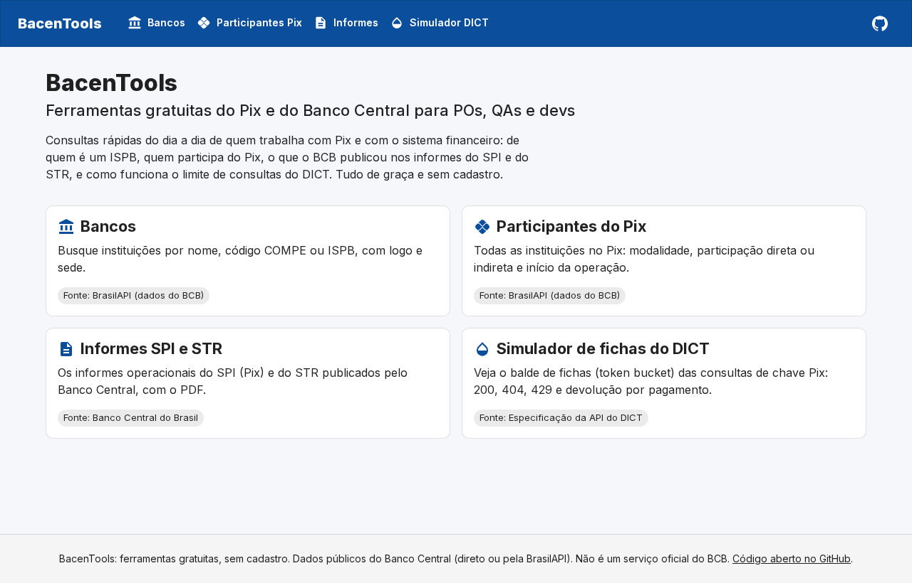
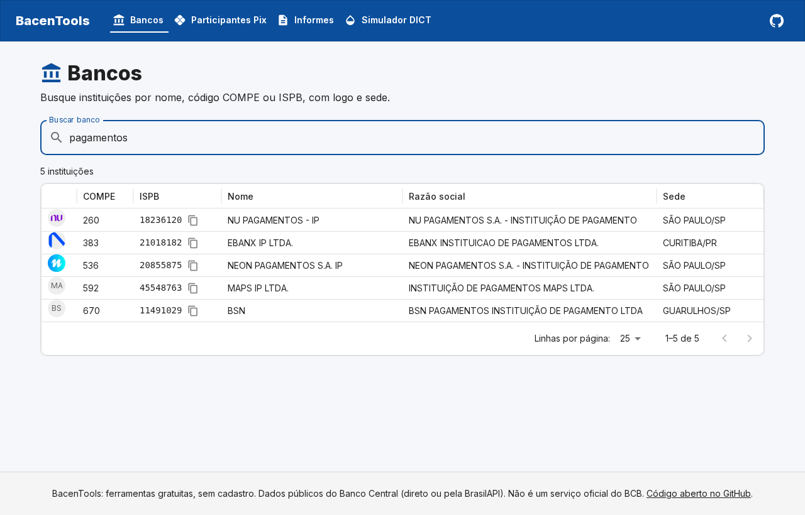
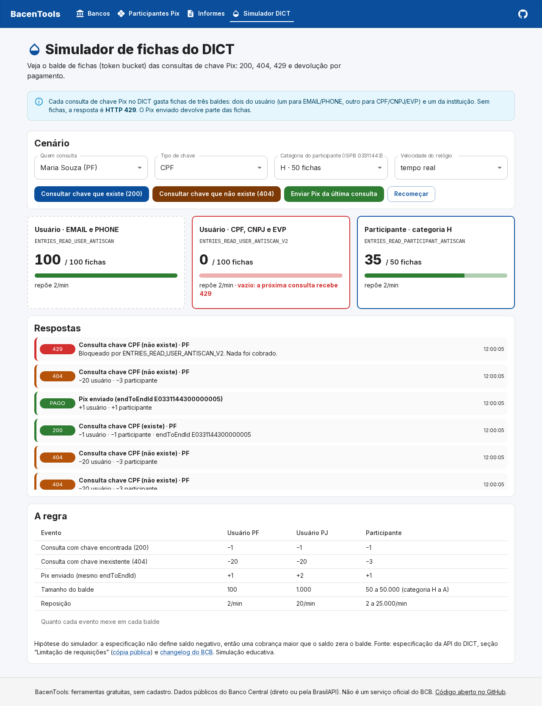

# BacenTools

[](https://github.com/vieiraes/bacentools/actions/workflows/ci.yml)
[](https://github.com/vieiraes/bacentools/actions/workflows/dados.yml)


**Ferramentas gratuitas do Pix e do Banco Central para POs, QAs e devs.** É um site estático, sem cadastro e sem servidor.

🔗 **https://bacentools.web.app**

| Ferramenta | O que faz | Fonte |
|---|---|---|
| [Bancos](https://bacentools.web.app/bancos/) | Busca por nome, COMPE ou ISPB, com logo e sede | BrasilAPI (dados do BCB) |
| [Participantes do Pix](https://bacentools.web.app/participantes-pix/) | 880 instituições, com modalidade, participação direta/indireta e início da operação | BrasilAPI (dados do BCB) |
| [Informes SPI e STR](https://bacentools.web.app/informes/) | Informes operacionais do BCB por ano, com o PDF | Banco Central |
| [Simulador de fichas do DICT](https://bacentools.web.app/simulador-dict/) | O *token bucket* das consultas de chave Pix: 200, 404, 429 e devolução por pagamento | Especificação da API do DICT |



<details><summary>Mais telas</summary>




</details>

## Estratégia de testes

Este projeto também é portfólio de QA. A pirâmide de testes é esta:

| Camada | Ferramenta | O que cobre |
|---|---|---|
| **Unidade e regra de negócio** | Vitest | A regra do DICT como função pura: **tabela de decisão** (200, 404 e 429 × saldo do usuário × saldo do participante), **valor-limite** (0; 0,99; 1; 20; teto) e reposição por tempo. Também a busca sem acento e a formatação de ISPB/COMPE. |
| **Propriedades** | fast-check | Para *qualquer* sequência de 80 operações em 300 rodadas: nenhum balde fica negativo ou passa do teto, o 429 nunca cobra e as funções não alteram o estado recebido. |
| **Contrato** | Vitest + zod + fixtures reais | Amostras gravadas da BrasilAPI e do BCB passam pelos validadores (`src/lib/sources/schemas.ts`). Se a fonte mudar de formato, o teste quebra antes da tela. |
| **Resiliência** | Vitest + `fetch` falso | A fonte caiu: o site usa a cópia diária. Caíram a fonte e a cópia: o erro original chega à tela. Um item quebrado é descartado sem derrubar a lista. |
| **E2E** | Playwright (desktop e celular) | Page Object, **rede simulada** (`page.route` com fixtures, sem depender da internet), **relógio controlado** (`page.clock`) para testar a reposição de fichas sem esperar minutos, redirecionamento 301 dos links antigos, sitemap e falha automática com erro no console. |
| **Acessibilidade** | axe-core | WCAG 2.2 AA em todas as páginas, no desktop e no celular, e sem rolagem lateral. |
| **Estático** | TypeScript estrito + ESLint | `npm run typecheck` e `npm run lint` na CI. |

A cobertura mínima é exigida pela CI: 95% das linhas e 90% dos ramos em `src/lib`, onde ficam as regras.

### Bugs que os testes encontraram

| Onde | Bug | Como foi pego |
|---|---|---|
| Simulador (versão antiga) | O Pix **gastava** ficha, mas no DICT o pagamento **devolve** | Revisão da regra contra a especificação, depois virou teste da tabela de decisão |
| Simulador (versão antiga) | Os status estavam trocados: o balde vazio devolvia 400 (deveria ser 429) e a chave inexistente devolvia 429 (deveria ser 404) | Tabela de decisão |
| Simulador (versão antiga) | O balde do ISPB ficava **negativo**: a regra conferia `≥ 1` e depois tirava 3 | Valor-limite e propriedade "nunca negativo" |
| Simulador (versão antiga) | Dois cliques no mesmo instante liam o mesmo saldo (condição de corrida) | Teste de regressão na *store* |
| Simulador | O balde inativo usava opacidade e o texto perdia contraste | axe |
| Simulador | A tabela da regra rolava de lado no celular sem poder receber foco pelo teclado | axe, só no projeto *mobile* |
| Site | A cor de aviso padrão do MUI e o botão não selecionado do ToggleButton não passam no contraste AA | axe |
| Site | "1 instituições" | Revisão das imagens do README, depois virou teste da função `plural` |

O relatório da avaliação que deu início a esse trabalho está em [docs/historico/](docs/historico/avaliacao-simulador-dict-2026-10.md).

## Arquitetura

```
src/
├── app/                    páginas (Next.js App Router, exportação estática)
├── components/             moldura, busca, tabela (DataGrid do MUI X, carregada só no navegador)
├── features/simulador/     tela e store do simulador (useSyncExternalStore)
└── lib/
    ├── domain/             regras puras, sem React: dict.ts (token bucket), text.ts (busca, formatos)
    └── sources/            BrasilAPI e BCB: validação com zod e fallback para a cópia diária
public/data/                cópia diária de bancos e participantes (GitHub Action "Atualizar dados")
tests/unit · tests/e2e      Vitest · Playwright
```

**Decisões:**
- **Sem servidor:** as fontes aceitam chamadas do navegador (CORS). Isso substituiu a antiga API NestJS no Fly.io: o site sai mais barato (de graça), mais simples e com menos pontos de falha.
- **Cópia diária como reserva:** se a BrasilAPI cair, o site continua de pé e mostra a data da cópia. O script só regrava a cópia quando a lista muda, para não inflar o histórico do git.
- **Regras isoladas em `lib/domain`:** dá para testar sem navegador e sem React.

**Stack:** Next.js 15 (Turbopack), React 19, TypeScript, MUI 9 + MUI X DataGrid, TanStack Query, zod, Vitest, fast-check, Playwright, axe-core, GitHub Actions e Firebase Hosting.

## Como rodar

```bash
npm ci
npm run dev          # http://localhost:3000
npm run test         # unidade, contrato e propriedades
npm run coverage     # com relatório em coverage/
npm run e2e          # build estático + Playwright (desktop e celular)
npm run snapshot     # atualiza a cópia diária em public/data
```

## Publicação

O workflow **CI** roda lint, tipos, testes unitários e E2E. Na `main`, publica no Firebase Hosting (projeto `bacentools`). Em pull request, publica um **link de pré-visualização** que vale 7 dias.

Para isso, ele precisa do segredo `FIREBASE_SERVICE_ACCOUNT_BACENTOOLS`, criado pelo comando `firebase init hosting:github`.

## Créditos e aviso

Os dados são públicos e vêm do [Banco Central do Brasil](https://www.bcb.gov.br) e da [BrasilAPI](https://brasilapi.com.br). O simulador é educativo e segue a especificação pública da API do DICT. **Este não é um serviço oficial do Banco Central.**

Este repositório reúne três projetos anteriores, que estão arquivados: a API `bacentools` (NestJS), o `bacentools-front` e o `simulador-fichas-bacen`.
